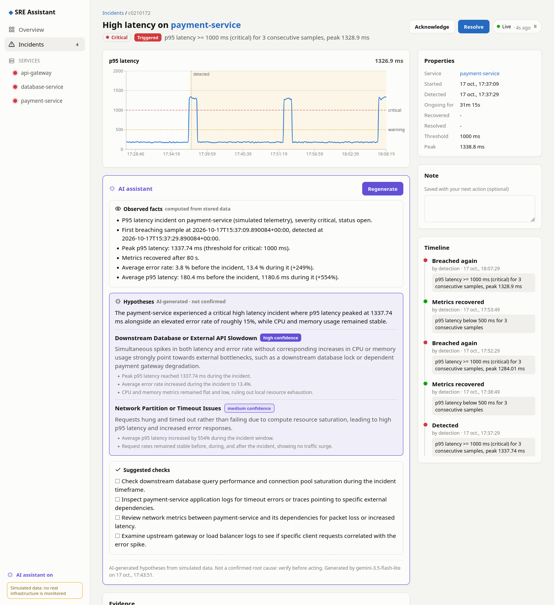
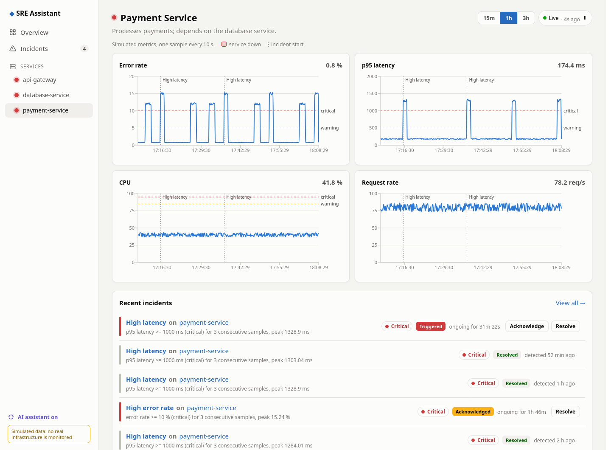
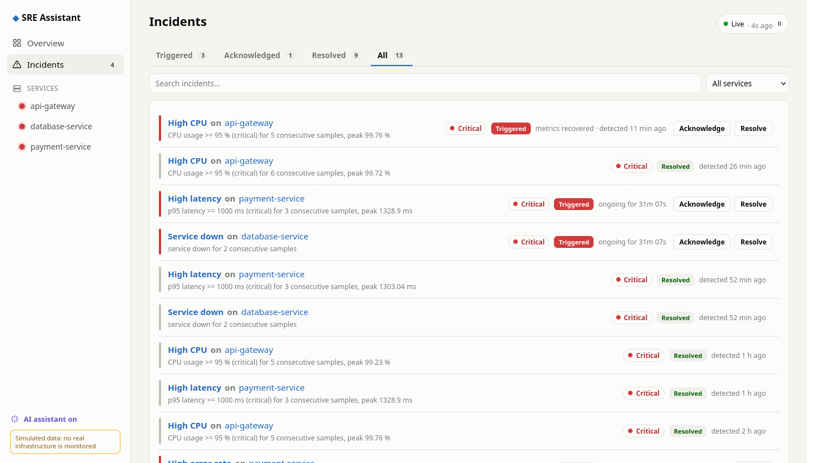

## The problem

When a production service degrades, an on-call engineer has to notice it, decide whether it
is a real incident, and investigate under pressure. I wanted to build the core of that loop
end to end: metrics coming in, incidents detected reliably, and a dashboard to follow them
from detection to resolution.

All telemetry is **simulated**: a separate process generates metrics for three services and
injects failure scenarios (error spike, latency, CPU saturation, database outage with a
cascade). Nothing monitors real infrastructure.

## What it does

- Ingests batches of metrics over an authenticated HTTP API.
- Detects incidents with deterministic rules (error rate, p95 latency, CPU, service down),
  with warning and critical severities, escalation and recovery.
- Tracks the incident lifecycle (`open → acknowledged → resolved`) and computes MTTA and MTTR.
- Shows services, metric charts with thresholds, and the incident queue in a React dashboard.
- On request, asks Google Gemini for hypotheses about an incident, displayed apart from the
  facts computed by the backend.

## Architecture

```
simulator ──POST /ingest (bearer token)──▶ API (FastAPI)
                                           │ route → incident manager
                                           │       → detection (pure rules)
                                           │       → repository (SQL)
browser ──▶ nginx (dashboard + /api) ─────▶│
                                           ▼
                                      PostgreSQL 17
```

Everything starts with one `docker compose up` command: PostgreSQL, a one-shot migration job,
the API, the simulator and nginx serving the dashboard.

## Engineering decisions

**Detection as pure functions.** The rules take samples and return decisions: no database,
no I/O, no wall clock (they use the sample timestamps). They can be unit tested exhaustively
and replayed deterministically. The trade-off is a separate layer that loads state and
persists the decisions in one transaction.

**Deduplication enforced by the database.** Requests for the same service are serialized by
a row lock, and a partial unique index allows only one unresolved incident per service and
rule. Even if application logic had a bug, two concurrent requests could not open the same
incident twice.

**Idempotent ingest.** Each sample is unique per service and timestamp, so a retried batch
is safe. That lets the simulator retry transient failures with exponential backoff without
creating duplicates.

**Severity from sustained breaches.** An incident opens only after N consecutive samples
above a threshold, and its severity is the level held by all of them. A single spike never
pages anyone as critical.

**AI as an optional, isolated feature.** The model is called only when a user clicks, behind
a provider interface. The backend computes the observed facts itself; the model only
suggests hypotheses, labelled as not confirmed. Quota, timeout and outage errors return a
clear message, and the application works fully without an API key.

**Hand-written migrations.** Alembic migrations are written by hand with explicit constraint
names, and CI fails if the models and the schema drift apart.

## Testing and CI

- 164 backend tests: unit tests for the pure detection rules and the simulator, and
  integration tests against a real PostgreSQL 17 database.
- Frontend type check and tests with Vitest.
- GitHub Actions runs linting, the migration drift check, all tests, the frontend build and
  both Docker image builds on every push.

## Limitations

- Read endpoints have no authentication yet: the project is meant to run locally, with every
  port bound to `127.0.0.1`.
- Metrics are stored in PostgreSQL, which is fine at this scale but not a time-series
  database.
- The dashboard polls the API every 5 seconds instead of receiving pushed updates.

## Screenshots






