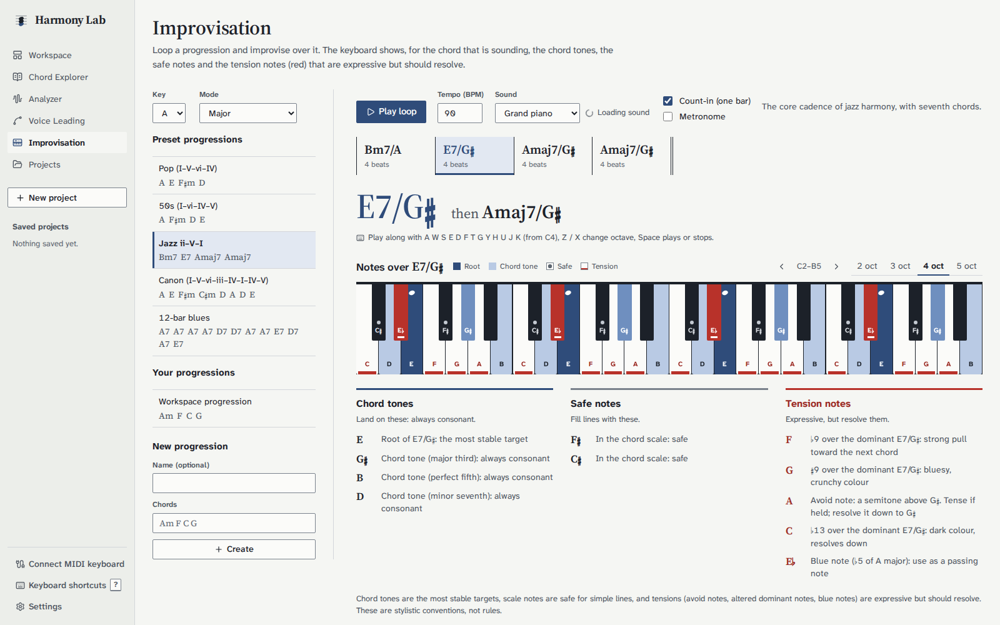
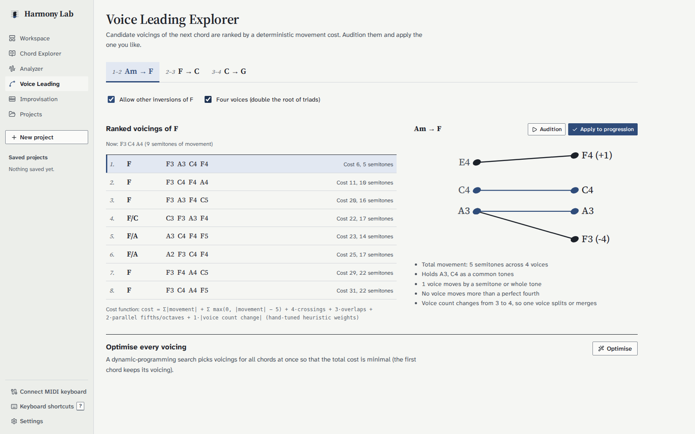
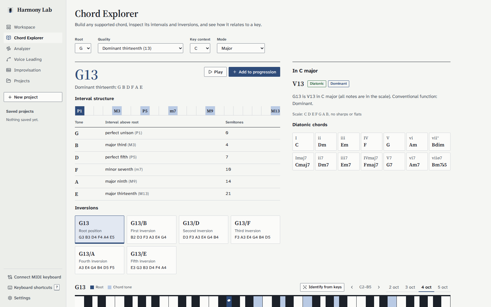
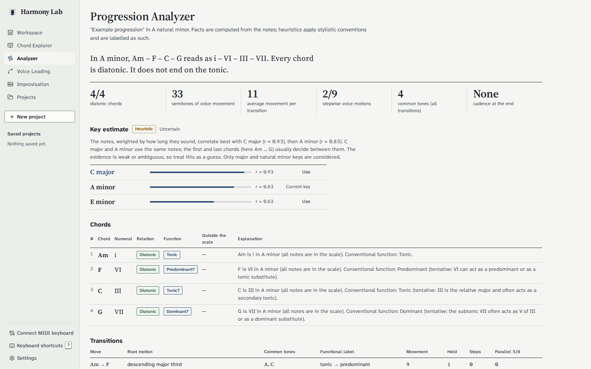

## The problem

As a pianist, I often want to try alternatives to a chord, see how the voices move into
the next one, and hear the result right away. Most tools either just play chords or show
theory without any context. I wanted one workspace where a progression can be built,
analysed, re-voiced and heard, with every result explained.

All the music theory is computed by deterministic code that I can test and explain.
The application does not depend on any external service.

## What it does

- Builds a chord progression from symbols (`Dm7`, `G/B`, `F#m7b5`, `G13`, `C7alt`) or pickers. Chords
  can be edited, reordered, duplicated, transposed and played, with undo and redo. Extended (9, 11, 13)
  and altered dominant chords are supported.
- Highlights the selected chord on an interactive piano keyboard, with the root marked and
  notes spelled correctly (E7 contains G#, not Ab).
- Works in major, natural, harmonic and melodic minor, and the five other church modes, and estimates
  the key of a progression (Krumhansl–Schmuckler) as an optional hint.
- Analyses the progression in a chosen key: Roman numerals, diatonic or borrowed chords,
  secondary dominants, cadences and voice movement. Each statement is labelled as a fact or
  a stylistic heuristic.
- Ranks voicings of the next chord by voice-leading cost, and re-voices the whole
  progression to minimise movement.
- Suggests alternative chords for four goals (smooth voice leading, stronger resolution,
  diatonic substitutes, more colour), each with a score breakdown and reasons.
- Loops preset or custom progressions for improvisation. For the chord that is sounding,
  the keyboard shows the chord tones, the safe scale notes and the tension notes (in red),
  each with a reason. Notes can be played along with the mouse or the computer keyboard.
- Plays with a sampled grand piano or five synthesised sounds, with a rhythm per chord (block, arpeggios,
  Alberti bass…), a count-in and a metronome.
- Connects a MIDI keyboard: notes sound with the chosen instrument, a held chord is named and can be
  added in one click. Progressions export to and import from MIDI files.
- Saves projects in PostgreSQL.
- Draws the progression like a line of a lead sheet: one measure per chord, sized by its
  number of beats, with a playhead during playback. A day and a night theme are available.

## Architecture

```
browser (React + Tone.js) ──▶ nginx (static app + /api) ──▶ Spring Boot API
                                                             │ theory/  stateless endpoints
                                                             │ project/ persistence (JPA)
                                                             │ music/   pure domain engine
                                                             ▼
                                                        PostgreSQL 17 (Flyway)
```

The backend is a modular monolith. The `music` package has no dependency on Spring, HTTP,
the database or audio. One `docker compose up` command starts the database, the API and the
frontend.

## Engineering decisions

**One source of musical truth.** Chords, keys, spelling and analysis exist only in the
Java domain, and the frontend asks the API instead of duplicating theory in TypeScript. The
cost is a short request per edit, handled with per-chord loading states that ignore stale
responses.

**Structured chords, not strings.** A chord is a root, a quality and an inversion. Text is
parsed and formatted in a single place. Notes are spelled letter by letter, so a Db minor
chord is Db–Fb–Ab.

**Voice leading with dynamic programming.** Voices are matched in pitch order, and a
dynamic program handles chords with different numbers of notes. A Viterbi-style search then
picks voicings for the whole progression by minimising the total cost, which a test checks
against a greedy chord-by-chord choice. The cost function is simple, documented and
hand-tuned: movement, extra cost for leaps, voice overlaps and parallel fifths.

**Explainable heuristics.** Suggestion scores are weighted sums of measured features. The
breakdown is returned with each result, and the interface presents scores as ranking aids,
not measures of musical quality. When no candidate is convincing, the engine says so instead
of filling the list.

**No silent data loss.** Chord order is an explicit column in the primary key. Updates carry
the version that was loaded, so an outdated save returns a conflict instead of overwriting
newer changes. All input is validated against the music model before anything is written,
in a single transaction.

**Improvisation guide as explicit rules.** For each chord, the key's scale is adjusted to
the chord's own notes (E7 in A minor turns G into G#). Notes a semitone above a chord tone,
the altered tensions of dominant chords and the blue notes are shown as tensions. These are
conventions from jazz and pop teaching, so each note comes with its reason rather than a
verdict.

**An interface that reads like a score.** Instead of a generic dashboard of cards, the
interface reuses the conventions musicians already read: measures, barlines, repeat signs
when looping, and Roman numerals under the chords as in a harmony textbook. Each colour has
one meaning: blue for the root and the selection, pale blue for chord tones, red for
tensions. Every role on the keyboard also has a shape, so colour is never the only cue, and
the text meets WCAG AA contrast in both themes. Accidentals are displayed as real ♭ and ♯
while the API keeps plain `b` and `#`. The night theme reuses the same colour tokens through
CSS `light-dark()`, and the keyboard stays ivory and black in both themes because it stands
for a real instrument.

**Extended chords and modes without special cases.** An extended or altered chord is just a longer list
of intervals (the ♭9 is a compound interval of 13 semitones), so spelling, inversions, identification and
Roman numerals needed no new code paths. Rules about dominants ask one method (`isDominantType`) instead
of checking a single chord type. A mode is a scale plus two properties: whether tonal functions apply
(not in Dorian or Lydian, where the app labels only the tonic) and which key signature it uses (harmonic
minor keeps the natural minor's).

**Key detection that admits doubt.** The key estimate correlates the duration-weighted notes with the
Krumhansl–Kessler profiles. C major and A minor contain the same notes, so when the two best keys are
relatives and close, the app reports low confidence and does not suggest a change; it never changes the
key on its own.

**Audio as a singleton.** Tone.js is loaded on the first click (browsers block audio
before a user gesture), a single engine exists per page, and progressions are scheduled on
the transport so tempo changes apply during playback.

## Testing and CI

- 236 backend unit tests for the domain (chords, intervals, keys, Roman numerals, voice
  leading, suggestions, improvisation guide, extended chords, modes, key detection, transposition),
  services and controllers.
- 16 integration tests against a real PostgreSQL database using Testcontainers: ordered
  persistence, validation errors, conflicts, atomic updates and constraints.
- 85 frontend tests with Vitest and React Testing Library, covering the editor, keyboard
  highlights, reordering, form validation, API errors, the improvisation page, rhythm patterns, MIDI
  file import/export, a simulated MIDI keyboard, transposition and the theme setting.
- GitHub Actions runs lint, type checking, all tests and the Docker image builds on every push.

## Limitations

- Single-user and meant to run locally: there is no authentication.
- Key detection only considers major and minor keys, and MIDI import recognises chords, not melodies.
- Web MIDI is not available in Safari.

## Screenshots










